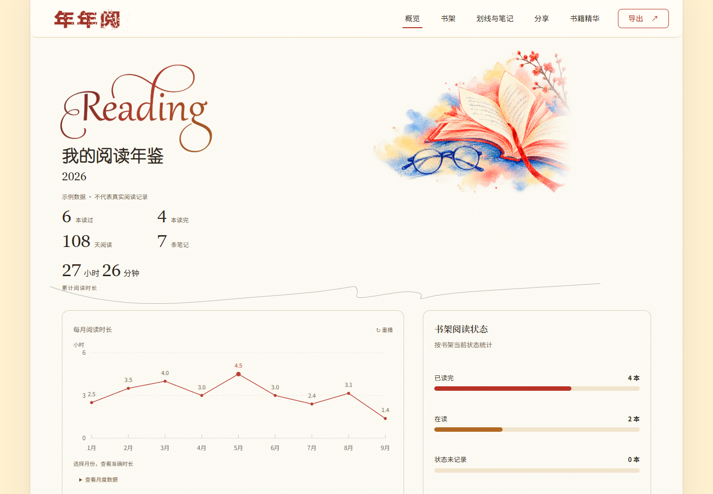
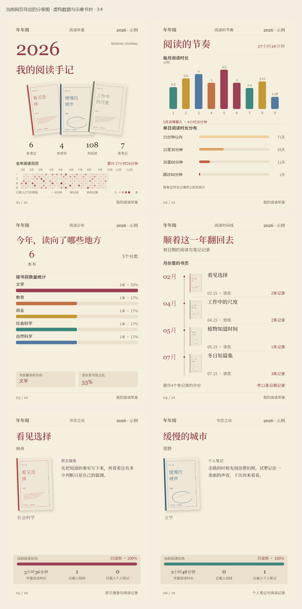

# 📚年年阅

把读过的书、划过的句子和随手写的想法，整理成一份可以浏览、保存和分享的阅读年鉴。

接入微信读书后，向助手说一句“生成我的年度阅读报告”，就能得到一份离线HTML：看看这一年读了什么、时间花在哪里，再挑几页导出成分享图。没有划线或笔记也没关系，已有的书单和统计照常呈现。

想多留下一点收获，也可以发来“书名＋作者”或上传电子书，让助手整理一份简短读书笔记。蒸馏是可选功能，可以单独使用。

## 开始使用

需要能运行Python、本地脚本并打开浏览器的AI助手。以下安装命令需要Node.js22.20.0或更高版本，可用`node -v`查看版本。

### 1.接入微信读书

安装腾讯官方微信读书Skill：

```bash
npx skills add Tencent/WeChatReading -g
```

按[腾讯官方说明](https://github.com/Tencent/WeChatReading)取得授权，在助手的本地环境中配置`WEREAD_API_KEY`。安装Skill本身不会读取账号；已有有效授权无需重复配置，过期后再更新。

APIKey不要写入项目文件、截图或公开对话记录。

### 2.安装年年阅

```bash
npx skills add Surge-Dan/reading-yearbook --skill reading-yearbook-skill -g
```

### 3.告诉助手你想做什么

```text
使用年年阅，根据我的2026年微信读书记录生成HTML阅读年鉴，分享图用3:4。
包含阅读统计、书架、阅读分布、时间线，以及已有划线和笔记。
生成后打开网页预览。
```

年份和比例按需替换。助手会采集或复用当前账号的记录，整理封面并生成网页，你不需要填写JSON或手动整理书单。授权失效、接口不支持或记录未取全时，会说明情况。

年度报告使用已授权的微信读书记录，或此前保存的同一账号材料；不以手动书单、其他平台记录或示例数据替代。已有HTML可以继续离线阅读；同步新记录时，授权仍需有效。

## 年鉴里有什么

| 内容 | 可以做什么 |
|---|---|
| 阅读概览 | 查看年度读书数量、阅读天数、时长和月度节奏 |
| 今年读过的书 | 搜索书名或作者，筛选阅读状态，切换网格与列表 |
| 阅读分布 | 看看书架的主题分布，以及已取得的分类投入 |
| 阅读时间线 | 按真实日期回看阅读事件，不补写缺失的时间 |
| 专注力排行 | 按已知年度逐书时长排序，展开书目或导出排行图；时长不等于连续专注时间 |
| 阅读侧写 | 从个人想法和划线观察四组阅读倾向，可展开查看依据，不作为心理测评 |
| 划线与笔记 | 区分原文摘录与个人想法，进入书籍详情回看 |
| 分享与导出 | 选择页面、书籍和比例，预览后下载 |
| 书籍精华 | 阅读助手整理的短笔记，复制正文或单独保存；没有结果时隐藏 |

书目和统计随你的记录变化。年度汇总、当前书架状态和已载入书目分别标明，缺失不当作零。阅读侧写默认先分析再展示，材料不足时不编造比例。

## 蒸馏一本喜欢的书

把电子书交给助手，再说：

```text
用年年阅整理这本书：这本书讲什么、最值得记住的观点、读完的启发、可靠金句和一段短书评。
已有阅读年鉴就加到末尾，否则生成独立阅读页。处理成本较高时先告诉我。
```

默认得到一份简短读书笔记：概览、少量核心观点、启发、可核对的金句和短书评。内容随书调整，小说不硬凑行动指南，没有可靠原文就不生成金句，材料不足时也不勉强写书评。

两种材料，对应两种处理方式：

- 上传电子书：基于提供的正文提炼。支持EPUB、TXT、Markdown；文本型PDF需要`pypdf`，不处理扫描件OCR或破解DRM。
- 提供“书名＋作者”：确认书籍身份后读取有限的公开资料，结果注明“基于公开资料，未核验全文”。不自动下载整书，也不凭记忆补写全文。

单独蒸馏不需要微信读书授权，也不需要另外配置模型APIKey。默认由当前助手分析，使用宿主模型服务及其额度；长书或额外收费会先确认。书名模式还需要联网检索工具。

完成后打开HTML阅读页。当前任务已有年鉴时，默认追加到末尾，保留原有统计和其他精华；新增蒸馏不会把一本书自动算进年度已读书单。可复制正文、导出Markdown或独立HTML，网页本身不执行蒸馏。

## 看看效果

下面使用虚构阅读记录与示意书封，展示当前版本的网页和分享图。



分享图由网页内同一套画布生成。首图用全年日历展示已取得的逐日阅读时长，其他页面分别呈现统计、分布、时间线和书卡。没有逐日明细时说明缺记录，不从月度汇总推算热度。



[下载示例HTML](reading-yearbook-skill/examples/reading-html-demo/index.html)后可离线体验，也可以[查看完整PNG组图](reading-yearbook-skill/examples/reading-html-demo/images/)。

## 挑几页，带走

分享区默认选中封面、阅读统计、阅读分布、阅读时间线和全部已载入的公开书籍。可以搜索、取消勾选，逐张预览；比例支持1:1、3:4和4:5。书卡按已有摘录、笔记和阅读信息排版，不补写你的感受。

| 格式 | 保存内容 |
|---|---|
| PNG | 当前预览的分享图 |
| ZIP | 所选页面，每页一张PNG |
| PDF | 带封面、统计、书单与笔记的阅读小册 |
| Markdown | 已载入的阅读资料，方便继续整理 |
| HTML | 离线年鉴；书籍精华也可单独导出阅读页 |

PNG和ZIP在浏览器内生成，无需额外安装截图工具。导出不会自动发布到任何平台。分享选择和比例保存在当前浏览器；换浏览器或换预览地址时，设置可能不同。

## 修改和使用边界

默认沿用随Skill安装的纸色、字体、插画和分享图设计，按你的数据调整内容。想微调时，直接指出位置即可：

```text
保留当前网页和分享图的风格，只把书卡的划线和笔记字号统一小一点。
其他地方不动。
```

修改已有作品会复用材料。修复数据和逻辑时不顺带更换主题；换风格、增加尺寸或额外生图，另行确认。

- 私密书目：过滤已标记为私密的书名、封面、笔记及相关精华，所有导出沿用过滤结果。年度汇总仍保留微信读书原口径，旧年鉴需重新生成才能应用新规则。
- 材料缺失：没有划线、笔记或精华也能使用；缺封面时显示书名占位，接口失败与确认零记录分开说明。
- 授权和缓存：APIKey从本地环境读取，不写入报告。缓存与书籍正文留在本机私人目录，不自动上传或发布；整份HTML仍可能含有你选择保留的私人笔记，分享前请检查。
- 本机预览：服务仅监听本机，只提供指定HTML，不开放工作目录。关闭服务后仍可离线打开HTML。
- 环境差异：当前验证以Windows桌面和Edge为主；其他宿主、移动端及任意数据组合不作已验证承诺。离线页面内嵌字体，加载失败时会回退系统字体。

## 项目说明

| 入口 | 内容 |
|---|---|
| [SKILL.md](reading-yearbook-skill/SKILL.md) | 助手任务路由与交付规则 |
| [HTML年鉴流程](reading-yearbook-skill/references/html-yearbook.md) | 采集、生成和导出 |
| [示例说明](reading-yearbook-skill/examples/README.md) | 当前示例与重建方式 |
| [架构说明](docs/architecture.md) | 代码结构、兼容范围和安全约定 |
| [测试说明](docs/testing.md) | 开发依赖、检查命令与验证边界 |

使用者只需安装Skill，`docs`和`tests`供开发维护，不是运行依赖。历史验收稿可在Git历史中查看。

图表部分改编自[lieflat-charts](https://github.com/larashero3-dotcom/lieflat-charts)，采用PolyFormNoncommercial1.0.0许可，商业使用需另行确认授权。Noto字体遵循OFL许可；其他资源保留各自来源与许可。

欢迎提Issue或PullRequest。请附上脱敏材料和复现步骤，排版问题带一张截图更好定位；不要上传密钥、整本电子书或私人阅读记录。

如果这份年鉴让你想留下来，欢迎点个⭐。
